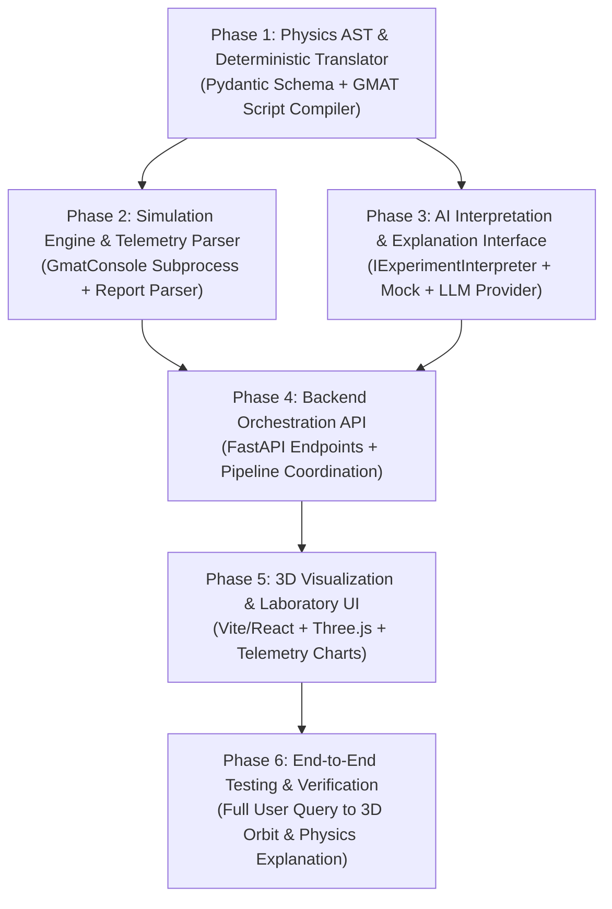

# OrbitLab: System Architecture & Specification

## A. Current Repository Assessment

| Aspect | Current Status | Notes |
| :--- | :--- | :--- |
| **Workspace Location** | `C:\Users\canit\DevSwarmProjects\Orbitlab` | Clean repository root |
| **Git Status** | Branch `main`, Commit `8cbe096` | Initial commit (empty tree) |
| **Repository Contents** | `.gitignore`, `.devswarm-temp/` | Clean workspace |
| **Frontend** | Not yet initialized | Greenfield |
| **Backend** | Not yet initialized | Greenfield |
| **Build System / Dependencies** | None currently committed | Python 3.13 / 3.11, Node.js v22.20.0, npm 11.8.0, Git 2.52.0 available on host |
| **Physics Simulation Engine** | NASA GMAT R2026a (Windows 64-bit) | Located at `C:\Users\canit\XY\Downloads\gmat-win-R2026a` |

---

## B. Proposed OrbitLab Architecture

OrbitLab enforces a strict decoupling between non-deterministic AI language understanding and deterministic physics execution.

### Architectural Diagram

```
+---------------------------------------------------------------------------------------+
|                                    User Interface                                     |
|    (React / Vite / TailwindCSS / Three.js 3D Viewport / Orbit Scrubbing & Telemetry)  |
+------------------------------------------+--------------------------------------------+
                                           | HTTP / WebSocket
                                           v
+---------------------------------------------------------------------------------------+
|                               FastAPI Backend Server                                  |
|                                                                                       |
|   1. NL Request ──────> [ AI Experiment Interpreter Interface ]                       |
|                                     │ (Domain Model / Structured Output)              |
|                                     v                                                 |
|   2. Validation <────── [ OrbitLab Experiment JSON ]                                  |
|         │                        (Pydantic AST)                                       |
|         v                                                                             |
|   3. Translation ─────> [ Deterministic GMAT Script Generator ]                       |
|                                     │ (Parameterized .script generator)               |
|                                     v                                                 |
|   4. Execution ───────> [ Sandboxed GMAT Runner Engine ]                              |
|                                     │ (GmatConsole.exe subprocess + timeout)          |
|                                     v                                                 |
|   5. Ingestion <─────── [ Simulation Output Parser ]                                  |
|         │                        (ReportFile / Ephemeris parser)                      |
|         v                                                                             |
|   6. Explanation ─────> [ AI Physics Explanation Engine ]                             |
|                                     │ (Orbital Mechanics Analysis)                    |
|                                     v                                                 |
|   7. Response ────────> { Trajectory JSON + Telemetry + AI Explanation }              |
+---------------------------------------------------------------------------------------+
```

### Component Boundaries

1. **AI Experiment Interpreter (`IExperimentInterpreter`)**:
   - Converts natural-language user experiments into structured `OrbitLabExperiment` JSON.
   - Decoupled interface to support general-purpose LLMs in development and specialized/domain-adapted models in production.
2. **Schema & Astrodynamic Sanity Validator**:
   - Enforces Pydantic v2 schemas and astrodynamic boundaries (e.g. periapsis radius $> R_{earth} + 100\text{ km}$, $0 \le e < 1$ for bound orbits, valid coordinate frames).
   - Rejects unphysical or unsafe configurations prior to compilation.
3. **Deterministic GMAT Script Generator**:
   - Translates the structured AST into valid, sanitized GMAT scripts.
   - **Crucial Rule**: The AI never generates raw GMAT script code directly. The generator utilizes deterministic templates and parameterized procedural builders.
4. **Sandboxed GMAT Runner Engine (`GmatExecutionEngine`)**:
   - Invokes `GmatConsole.exe` in headless mode within temporary, run-isolated workspaces.
   - Implements execution timeouts and process isolation.
5. **Simulation Output Parser**:
   - Reads GMAT `ReportFile` tab/space-delimited telemetry into memory.
   - Extracts cartesian vectors $(X, Y, Z, V_x, V_y, V_z)$, Keplerian elements $(a, e, i, \Omega, \omega, \theta)$, and maneuver milestones.
   - Provides adaptive downsampling for 60fps WebGL rendering.
6. **AI Physics Explanation Engine (`IPhysicsExplainer`)**:
   - Compares initial experiment parameters against empirical simulation outcomes.
   - Generates educational and analytical orbital mechanics explanations.
7. **Laboratory Web UI**:
   - Interactive 3D orbital viewer (Three.js), natural language prompt console, parameter inspector, and telemetry timelines.

---

## C. Preliminary Experiment JSON Schema

```json
{
  "$schema": "http://json-schema.org/draft-07/schema#",
  "title": "OrbitLabExperiment",
  "type": "object",
  "required": ["version", "experimentName", "spacecraft", "initialOrbit", "propagation"],
  "properties": {
    "version": { "type": "string", "enum": ["1.0"] },
    "experimentName": { "type": "string", "maxLength": 100 },
    "description": { "type": "string" },
    "spacecraft": {
      "type": "object",
      "required": ["name", "dryMassKg"],
      "properties": {
        "name": { "type": "string", "pattern": "^[A-Za-z0-9_]{1,30}$" },
        "dryMassKg": { "type": "number", "minimum": 0.1, "maximum": 500000 },
        "coefficientOfDrag": { "type": "number", "default": 2.2, "minimum": 0, "maximum": 5.0 },
        "dragAreaM2": { "type": "number", "default": 1.0, "minimum": 0.01, "maximum": 1000 },
        "coefficientOfReflectivity": { "type": "number", "default": 1.8, "minimum": 0, "maximum": 2.0 },
        "srpAreaM2": { "type": "number", "default": 1.0, "minimum": 0.01, "maximum": 1000 }
      }
    },
    "centralBody": {
      "type": "string",
      "enum": ["Earth", "Moon", "Mars"],
      "default": "Earth"
    },
    "epoch": {
      "type": "object",
      "required": ["format", "value"],
      "properties": {
        "format": { "type": "string", "enum": ["UTCGregorian"], "default": "UTCGregorian" },
        "value": { "type": "string", "default": "01 Jan 2026 12:00:00.000" }
      }
    },
    "initialOrbit": {
      "type": "object",
      "required": ["type", "coordinateSystem", "elements"],
      "properties": {
        "type": { "type": "string", "enum": ["Keplerian", "Cartesian"] },
        "coordinateSystem": { "type": "string", "enum": ["EarthMJ2000Eq"], "default": "EarthMJ2000Eq" },
        "elements": {
          "type": "object",
          "properties": {
            "semiMajorAxisKm": { "type": "number", "minimum": 6478.137 },
            "eccentricity": { "type": "number", "minimum": 0.0, "maximum": 0.99 },
            "inclinationDeg": { "type": "number", "minimum": 0.0, "maximum": 180.0 },
            "raanDeg": { "type": "number", "minimum": 0.0, "maximum": 360.0 },
            "argumentOfPeriapsisDeg": { "type": "number", "minimum": 0.0, "maximum": 360.0 },
            "trueAnomalyDeg": { "type": "number", "minimum": 0.0, "maximum": 360.0 },
            "xKm": { "type": "number" },
            "yKm": { "type": "number" },
            "zKm": { "type": "number" },
            "vxKmS": { "type": "number" },
            "vyKmS": { "type": "number" },
            "vzKmS": { "type": "number" }
          }
        }
      }
    },
    "forceModel": {
      "type": "object",
      "default": {},
      "properties": {
        "gravityDegree": { "type": "integer", "minimum": 0, "maximum": 20, "default": 4 },
        "gravityOrder": { "type": "integer", "minimum": 0, "maximum": 20, "default": 4 },
        "pointMasses": {
          "type": "array",
          "items": { "type": "string", "enum": ["Luna", "Sun", "Jupiter"] },
          "default": ["Luna", "Sun"]
        },
        "atmosphericDrag": {
          "type": "object",
          "properties": {
            "enabled": { "type": "boolean", "default": false },
            "model": { "type": "string", "enum": ["JacchiaRoberts", "MSISE90"], "default": "JacchiaRoberts" }
          }
        },
        "solarRadiationPressure": { "type": "boolean", "default": true }
      }
    },
    "maneuvers": {
      "type": "array",
      "items": {
        "type": "object",
        "required": ["id", "type", "trigger"],
        "properties": {
          "id": { "type": "string", "pattern": "^[A-Za-z0-9_]{1,20}$" },
          "type": { "type": "string", "enum": ["ImpulsiveBurn", "TargetedHohmannTransfer"] },
          "trigger": {
            "type": "object",
            "required": ["condition"],
            "properties": {
              "condition": { "type": "string", "enum": ["AtPeriapsis", "AtApoapsis", "ElapsedTimeSecs"] },
              "elapsedSecs": { "type": "number", "minimum": 0 }
            }
          },
          "burnVector": {
            "type": "object",
            "properties": {
              "coordinateSystem": { "type": "string", "enum": ["LocalVNB"], "default": "LocalVNB" },
              "deltaVVectorKmS": {
                "type": "array",
                "items": { "type": "number" },
                "minItems": 3,
                "maxItems": 3,
                "description": "[V_velocity, N_normal, B_binormal] in km/s"
              }
            }
          },
          "targetObjectives": {
            "type": "object",
            "properties": {
              "targetOrbitRadiusKm": { "type": "number", "minimum": 6500 },
              "targetEccentricity": { "type": "number", "minimum": 0.0, "maximum": 0.99 }
            }
          }
        }
      },
      "default": []
    },
    "propagation": {
      "type": "object",
      "required": ["stopCondition"],
      "properties": {
        "integrator": { "type": "string", "enum": ["RungeKutta89", "PrinceDormand78"], "default": "RungeKutta89" },
        "stopCondition": {
          "type": "object",
          "required": ["type", "value"],
          "properties": {
            "type": { "type": "string", "enum": ["ElapsedDays", "ElapsedHours", "ElapsedSeconds", "OrbitPeriods"] },
            "value": { "type": "number", "minimum": 0.001, "maximum": 365.0 }
          }
        },
        "stepSizeSecs": { "type": "number", "minimum": 0.1, "maximum": 3600.0, "default": 60.0 }
      }
    }
  }
}
```

---

## D. GMAT Integration Approach

### 1. Programmatic Invocation
- Backend will execute `GmatConsole.exe` via asynchronous subprocesses:
  ```powershell
  & "C:\Users\canit\XY\Downloads\gmat-win-R2026a\bin\GmatConsole.exe" --run <script_path> --exit
  ```
- Subprocess execution ensures strict process isolation, timeout enforcement, and memory safety without crashing the API backend.
- Benchmark during reconnaissance confirmed execution in **0.047 seconds** for typical propagation sequences.

### 2. Output Retrieval
- Scripts will deterministically define a `ReportFile` subscriber emitting space/tab-delimited tables:
  ```matlab
  Create ReportFile OrbitLabReport;
  OrbitLabReport.Filename = '<run_dir>/telemetry.txt';
  OrbitLabReport.Precision = 8;
  OrbitLabReport.WriteHeaders = true;
  OrbitLabReport.Add = {Sat.ElapsedSecs, Sat.EarthMJ2000Eq.X, Sat.EarthMJ2000Eq.Y, Sat.EarthMJ2000Eq.Z, ...
                        Sat.EarthMJ2000Eq.VX, Sat.EarthMJ2000Eq.VY, Sat.EarthMJ2000Eq.VZ, ...
                        Sat.Earth.SMA, Sat.Earth.ECC, Sat.Earth.INC, Sat.Earth.Altitude};
  ```
- Output is ingested into typed numerical data structures, validated, and normalized for API delivery.

---

## E. Recommended DevSwarm Workspaces & Workstreams

| Workspace | Domain | Key Responsibilities | Dependencies |
| :--- | :--- | :--- | :--- |
| **`orbitlab-physics-core`** | AST & Script Compiler | Pydantic Experiment schemas, physical validator, deterministic GMAT script generator, compiler unit tests | None |
| **`orbitlab-simulation-engine`** | GMAT Execution & Parsing | Subprocess runner (`GmatConsole.exe`), sandbox management, timeout watchdog, `ReportFile` telemetry parser | `orbitlab-physics-core` |
| **`orbitlab-ai-interpreter`** | Language & Explanation | `IExperimentInterpreter` interface, structured output LLM adapter, mock interpreter, physics explainer prompts | `orbitlab-physics-core` |
| **`orbitlab-api-service`** | Backend Orchestrator | FastAPI service, REST & WebSocket routes, pipeline coordination, caching | Core, Engine, & AI |
| **`orbitlab-web-ui`** | 3D Visualization & UX | React / Vite / Three.js 3D Earth & orbit viewport, prompt console, telemetry graphs, parameter inspector | API Service (or mock) |

---

## F. Risks and Technical Constraints

1. **Targeter Divergence**: GMAT differential correctors can fail to converge if initial perturbation bounds are unconstrained. Mitigated by bounded solve parameters and defensive error propagation.
2. **Path Separator Formatting**: Windows backslashes in GMAT scripts cause escape errors. Mitigated by strict forward-slash (`/`) path normalization across all generated scripts.
3. **AI Hallucinations**: Addressed by strict Pydantic astrodynamic boundary checks ($r_p \ge R_E + 100\text{ km}$, $0 \le e < 1$) before script generation.
4. **Telemetry Volume**: Multi-orbit runs create large data files. Mitigated by server-side decimation keeping WebGL coordinate payloads $\le 2000$ points.

---

## G. Implementation Plan (Ordered by Dependency)



## H. Current state (November 2026)

The sections above are the original plan and are kept unchanged. What follows describes the code as it actually is.

### Central bodies, frames, stop conditions

- Seven central bodies: Earth, Moon, Mars, Mercury, Venus, Jupiter, Sun (constants in `orbitlab_core/constants.py`, single source `orbitlab_core/bodies.json`).
- Coordinate systems: EarthMJ2000Eq, LunaMJ2000Eq, MarsMJ2000Eq, MercuryMJ2000Eq, VenusMJ2000Eq, JupiterMJ2000Eq, SunMJ2000Eq (body-matched by the validator).
- Four stop-condition types: ElapsedSeconds, ElapsedHours, ElapsedDays, OrbitPeriods. The front step passes the user's own unit through unchanged (seconds stay seconds, minutes become seconds, orbit counts stay orbit periods); the model is never sent a converted unit.
- Names are owned by Python: after the interpreter answers, `experimentName` and `spacecraft.name` are overwritten with the front-step values (sanitised to `^[A-Za-z0-9_]{1,30}$`), a name difference warns but never fails. Altitudes are converted to semi-major axis deterministically; questionable numbers are passed through and explained by validation afterwards.

### Where phase 4 lives now

- Backend code: `phase4_backend/orbitlab_backend/` (config, `clients/` interpreter/extractor/explainer, `frontstep/` extractor/conversions/prompt_builder/verify, `orchestrator/` pipeline/errors, `api/` FastAPI app/store/cleanup/adapter). Backend tests: `tests/` (run from inside `phase4_backend/`), route-level end-to-end suite: `tests/e2e/`, all-suites runner: `scripts/e2e_all.py`.
- Reports: `phase4_backend/` (task reports including `extractor_*`,
  `explain_fallback_report.md`, `demo_mode_report.md`, `ui_real_results_report.md`,
  `plots_report.md`, `view3d_report.md`, `ground_track_report.md`,
  `details_tab_report.md`, `open_in_gmat_report.md`, `bundled_gmat_report.md`,
  `realistic_cases_report.md` + generated `realistic_cases_results.md`,
  `docs_report.md`, plus the earlier phase4/phase5/phase6 reports),
  `RUNBOOK.md`, `deploy_notes.md`, `.env.example` (complete: every setting
  the code reads, values empty); review notes under `phase4_backend/review/`.
  Test fixtures live in `tests/fixtures/` (incl. a real anonymised run);
  GMAT bundles, when downloaded, live in untracked `tools/gmat/`.
- UI: `UIUX/OrbitlabUI Main/` (the wired Main UI, served at `/` by redirect and at `/main/`), static assets served from `UIUX/` with the adapter at `/ui_adapter.js`. Tabs: Chat, Understanding, Results, Graph, Physics, Details. Main UI extras: 2D/3D orbit views (vendored three.js), altitude/speed/sma/eccentricity plots with hover, maneuver table with analytic Hohmann estimates, Earth ground track, `/sample-result` fixture mode (`?fixture=1`), demo-mode and "Open in GMAT" header badges.

### Real pipeline stages

`extract -> interpret -> verify -> validate -> compile -> simulate -> parse -> explain`, emitting `stage_started/completed/failed` events plus `model_warming_up` and `interpreter_name_overridden` over `GET /api/experiments/{id}` and `WS /ws/experiments/{id}`. Every failure carries a human-readable message and an `explanation`. In-memory job store and prompt cache are bounded; the interpreter client is OpenAI-compatible (`POST {base}/v1/chat/completions`) with one retry on timeout/502/503/504 only.

### Status update (November 2026)

Since §H was written the pipeline gained: a demo mode (`ORBITLAB_DEMO_MODE`,
deterministic local extractor/interpreter, `mode: "demo"` on health and
results, `DEMO MODE` UI badge); kept compiled scripts per run with
`GET /api/experiments/{id}/script` and `hasScript`; an optional local
"Open in GMAT" action (`ORBITLAB_ALLOW_OPEN_GMAT`, `openInGmat` health flag,
127.0.0.1/::1 only); a bundled-GMAT fallback (`tools/gmat/**/bin/
GmatConsole(.exe)`, explicit `GMAT_PATH` wins, INFO-logged); a scripted
realistic-cases runner (`scripts/realistic_cases.py`); and a `details` UI
tab (read-only experiment JSON + script viewer). The `errors.py` codes now
include `extractor_unavailable` alongside the original list. None of this
changes the guarantees below.

### Safety and verification chain

Three independent layers stand between the language models and GMAT. Each
states what it guarantees — and what it does not.

1. **verify** (`frontstep/verify.py`, deterministic): re-checks every number
   the interpreter returned — central body, dry mass (rel 1e-9),
   semi-major axis (abs 0.001 km), eccentricity/inclination/RAAN/
   argument-of-periapsis/true-anomaly (rel 1e-9), integrator,
   stop-condition type and value, explicit force-model fields, maneuver
   count/target-radius/Δv — against the front step's own conversion, and
   overwrites model-provided names with Python-owned ones (warning, never
   failing on names). It guarantees the experiment matches the converted
   request; it does *not* judge physical safety — anything that parses
   goes through to validation.
2. **validator** (`AstrodynamicValidator`, deterministic): enforces physics —
   minimum periapsis altitude per body, eccentricity below 1, drag refused
   where no atmosphere model exists (only Earth allows it), point-mass-only
   bodies flagged, schema caps (365 d / 8760 h / 31536000 s / 365 periods),
   coordinate frame matched to the body, maneuver checks (impulsive Δv >
   15 km/s or exactly 0 warns; Hohmann target periapsis below the safe
   radius, or a Hohmann from an unbound orbit, is an error), and a warning
   when the step size exceeds the total duration. It guarantees no
   unphysical or unsafe experiment reaches the compiler; it does *not*
   check mission sense (a valid but pointless orbit passes).
3. **compiler** (`GmatScriptCompiler`, deterministic templates only):
   translates the validated AST into GMAT script with sanitised identifiers
   and fixed file layouts. It guarantees the script is syntactically shaped
   by code, never by model text (the model never sees script); it does *not*
   guarantee the mission is sensible — that is the validator's job above,
   and the human's job afterwards (see the research-use notice in the UI).

On top of this chain: needs-clarification for missing fields instead of
invented values; bounded in-memory job store and prompt cache; no secret
ever logged, returned, or committed (names only).
