# OrbitLab

OrbitLab turns a plain-English space-mission request into a real orbital-mechanics
simulation: a language model reads the request and fills in a structured experiment,
a deterministic compiler turns that experiment into a GMAT script with no model
involvement in the code generation, and the validator between them rejects anything
physically unsafe before anything is compiled or flown — so what you see plotted
is what NASA's General Mission Analysis Tool actually propagated.

```mermaid
flowchart LR
    U["natural-language request"] --> E["extract\n(LM: hosted extractor;\nfalls back to regex)"];
    E --> I["interpret\n(LM: hosted interpreter)"];
    I --> V["verify\n(deterministic)"];
    V --> VA["validate\n(deterministic)"];
    VA --> C["compile\n(deterministic)"];
    C --> S["simulate\n(deterministic:\nreal GMAT or synthetic)"];
    S --> P["parse\n(deterministic)"];
    P --> X["explain\n(LM with deterministic\nfallback)"];
    X --> R["result + telemetry + script"];
```



Stages marked LM call a hosted model; every other stage is deterministic code.

## Requirements

- Python 3.10+ with `pip install fastapi pydantic-settings httpx uvicorn websockets python-dotenv pytest pytest-asyncio`
  (`orbitlab_core` needs `pydantic>=2.5.0`; see `pyproject.toml`).
- Node.js only for the front-end unit tests (`node --test`).
- GMAT is optional: without it the simulate stage returns a synthetic 10-point
  trajectory. See "Getting GMAT" below for the real simulator.

## Quick start in DEMO mode (no keys)

From the repo root:

```powershell
$env:ORBITLAB_DEMO_MODE='true'
$env:PYTHONPATH='phase4_backend'
python -m uvicorn orbitlab_backend.api.app --port 8000
```

```bash
export ORBITLAB_DEMO_MODE=true
PYTHONPATH=phase4_backend python -m uvicorn orbitlab_backend.api.app --port 8000 &
```

Open http://127.0.0.1:8000/main, describe an orbit in Chat, and watch it run.

Prefer a desktop window over a browser tab: `python -m pip install -r
requirements-desktop.txt`, then `.\scripts\start_desktop.ps1 [-Demo]` —
same backend and Main UI in a resizable 1400x900 `OrbitLab` window
(127.0.0.1 only); see `phase4_backend/RUNBOOK.md` → "Desktop window".
Demo mode uses a deterministic local extractor and interpreter (no network,
no keys) with the real GMAT simulator when `GMAT_PATH` is set. Unset
`ORBITLAB_DEMO_MODE` (or restart without it) to return to model mode.

## Quick start with real models

Set the secret values only in your shell or a local `.env` file (never
committed). Names only below — see `.env.example` for the full list:

```powershell
$env:ORBITLAB_MODEL_URL='<your-model-endpoint>'
$env:ORBITLAB_MODEL_KEY='<your-key>'
$env:EXTRACTOR_BASE_URL='<your-extractor-endpoint>'
$env:EXTRACTOR_API_KEY='<your-key>'
$env:EXTRACTOR_MODEL='<your-deployment>'
$env:PYTHONPATH='phase4_backend'
python -m uvicorn orbitlab_backend.api.app --port 8000
```

```bash
export ORBITLAB_MODEL_URL='<your-model-endpoint>' ORBITLAB_MODEL_KEY='<your-key>'
export EXTRACTOR_BASE_URL='<your-extractor-endpoint>' EXTRACTOR_API_KEY='<your-key>'
export EXTRACTOR_MODEL='<your-deployment>'
PYTHONPATH=phase4_backend python -m uvicorn orbitlab_backend.api.app --port 8000 &
```

The first request after the models go idle can take ~90 s (cold start);
timeouts and retries are configured via `ORBITLAB_MODEL_TIMEOUT_S` and
`EXTRACTOR_TIMEOUT_S` (see `phase4_backend/RUNBOOK.md`).

## How the models are hosted

The interpreter is a Phi-4-mini fine-tune served with vLLM as the Modal app
`orbitlab-interpreter`; the extractor is Qwen2.5-7B-Instruct served as the
Modal app `orbitlab-extractor`. Both expose OpenAI-compatible
`/chat/completions` endpoints that the backend calls with Bearer keys from
environment variables.

## Getting GMAT

Without GMAT the backend returns a synthetic trajectory. For the real thing,
either keep a `GmatConsole` on disk and point at it, or download a build once
into `tools/gmat/` (explicit `GMAT_PATH` always wins; see
`phase4_backend/RUNBOOK.md` → "Getting GMAT"):

```powershell
.\scripts\setup_gmat.ps1 -Url '<paste-the-release-zip-link>'
$env:GMAT_PATH='C:\GMAT\R2024a\bin\GmatConsole.exe'
```

```bash
./scripts/setup_gmat.sh --url '<paste-the-release-zip-link>'
GMAT_PATH='<path-to>/bin/GmatConsole' python scripts/e2e_all.py
```

`tools/gmat/` is git-ignored (binaries are never committed); only
`tools/gmat/README.md` is tracked.

## Features

- **Orbital view**: 2D SVG trajectory card and a real 3D scene (three.js r160,
  vendored locally, no CDN), with a moving spacecraft marker, replay, play/
  pause/speed, and a draggable time slider.
- **Plots**: altitude, speed, semi-major axis and eccentricity vs time with
  hover readouts and a maneuver table with analytic Hohmann estimates.
- **Ground track**: equirectangular Earth track with day/night-agnostic grid,
  wrap handling at ±180°, labelled approximate (~0.2°).
- **Details tab**: read-only experiment JSON and the generated GMAT script
  with copy buttons, plus a research-use notice.
- **Open in GMAT**: optional local-only button that opens the stored script
  in the desktop GMAT app (off by default).
- **Demo mode**: full pipeline with no keys (deterministic local models,
  real GMAT).

## Running the tests

```powershell
cd phase4_backend
python -m pytest ../tests -q
```

```powershell
python -m pytest orbitlab_core/tests -q
python -m pytest simulation_engine/tests -q
node --test tests/plots.test.cjs tests/ui_helpers.test.cjs tests/ui_render.test.cjs tests/view3d.test.cjs tests/groundtrack.test.cjs
$env:GMAT_PATH='<path-to>\GmatConsole.exe'; python scripts/e2e_all.py
```

```bash
cd phase4_backend && python -m pytest ../tests -q && cd ..
python -m pytest orbitlab_core/tests -q
python -m pytest simulation_engine/tests -q
node --test tests/plots.test.cjs tests/ui_helpers.test.cjs tests/ui_render.test.cjs tests/view3d.test.cjs tests/groundtrack.test.cjs
GMAT_PATH='<path-to>/bin/GmatConsole' python scripts/e2e_all.py
```

Without `GMAT_PATH`, the GMAT-gated tests skip with a reason. Details and
history live in `phase4_backend/*_report.md`; runbooks in
`phase4_backend/RUNBOOK.md` and `phase4_backend/deploy_notes.md`.

## Supported scope (read from the code and schema)

- 7 central bodies (Earth, Moon, Mars, Mercury, Venus, Jupiter, Sun) with
  per-body inertial frames (`*MJ2000Eq`).
- Keplerian initial orbits (semi-major axis, eccentricity, inclination,
  RAAN, argument of periapsis, true anomaly); Cartesian states accepted.
- Hohmann transfers (`TargetedHohmannTransfer`, apsis triggers) and impulsive
  burns (`ImpulsiveBurn`, apsis or elapsed-time triggers, LocalVNB Δv).
- Durations: seconds, minutes, hours, days, orbit counts
  (`ElapsedSeconds/ElapsedHours/ElapsedDays/OrbitPeriods`); schema caps of
  365 days / 8760 hours / 31536000 seconds / 365 orbit periods.
- Atmospheric drag is allowed only for Earth; Mercury, Jupiter and the Sun
  are point-mass only (a warning, not an error); minimum periapsis altitudes
  per body are enforced (e.g. 100 km for Earth and Venus).
- Pipeline stages: extract, interpret, verify, validate, compile, simulate,
  parse, explain; every failure carries a stage, a machine-readable code,
  and a human-readable explanation.

## Known limitations

- In demo mode a bare "burn at apoapsis" with no target and no delta-v is
  dropped (no validator-valid maneuver exists for it); "400 km circular"
  without the word "orbit" or "altitude" is not read as an orbit.
- The ground track is approximate (spherical Earth, no precession, nutation,
  or polar motion — up to ~0.2° error).
- Hohmann rows show analytic delta-v estimates for an impulsive coplanar
  transfer, not values measured from the simulation (telemetry carries no
  executed delta-v fields, so there is nothing to label "from simulation").
- No browser was available here: interactive visuals were asserted with
  stub-DOM Node tests, not pixels; see the per-task reports for what was
  and was not visually verified.

## Project layout

- `orbitlab_core/` — AST schemas (Pydantic), physical validator, deterministic
  GMAT script compiler.
- `simulation_engine/` — GMAT runner (sandboxed subprocess, timeouts) and
  telemetry parsing.
- `phase4_backend/orbitlab_backend/` — FastAPI backend: `api/` (routes, job
  store, run-folder cleanup, UI adapter), `clients/` (real + mock model
  clients), `frontstep/` (extraction, conversions, prompt builder, verify,
  demo parser), `orchestrator/` (pipeline, typed errors, run estimator).
- `phase4_backend/` — runbook, deploy notes, task reports, UI test fixtures.
- `UIUX/OrbitlabUI Main/` — the Main UI (single `app.js`, vendored three.js,
  `plots.js`, `view3d.js`, `groundtrack.js`); served by the backend at `/main`.
- `scripts/` — `e2e_all.py` (all-suites runner), `debug_extractor.py`,
  `smoke_real_model.py`, `realistic_cases.py` (API prompt runner),
  `setup_gmat.ps1` / `setup_gmat.sh` (GMAT downloader).
- `tests/` (+ `tests/e2e/`) — backend and API tests; `tests/fixtures/` holds a
  real (anonymised) run used by the UI fixture mode and several tests.
- `tools/gmat/` — your local GMAT copy (untracked; see its README).

## How the AI is used and checked

The two language models only ever *read and write text*. The extractor turns
your sentence into structured fields; the interpreter turns the canonical
prompt into experiment JSON. Neither model writes GMAT script and neither
decides what is safe to fly. Two deterministic gates stand between the models
and the simulator. First, **verify** re-checks every number the interpreter
returned against the front step's own conversion (semi-major axis,
eccentricity, inclination, stop condition, maneuvers) and fails the run on
any mismatch instead of guessing. Then **the validator** checks physics that
no prompt can override: the orbit must stay above the body's minimum
periapsis altitude, eccentricity must be below 1, drag is refused where no
atmosphere model exists, and durations must fit the schema caps. Only a run
that passes both gates is compiled — by fixed templates, never by the
model — and handed to GMAT. The explainer that narrates the result is also a
model, but if it fails or is unconfigured the run still succeeds with a
clearly-labelled automatic summary, never an invented explanation.

## Disclaimer

OrbitLab is a research and education tool. Always review the generated GMAT
script and results before relying on them. Not for flight operations.

## Credits

- NASA General Mission Analysis Tool (GMAT), Apache 2.0,
  https://github.com/nasa/GMAT, used unmodified, its License.txt kept with
  any bundled copy.
- Planet textures taken from GMAT's data/graphics/texture folder with their
  original authors named: JPL/Caltech, Bjorn Jonsson, Celestia Motherlode
  contributors.
- Language models Phi-4-mini and Qwen2.5-7B-Instruct used under their own
  licenses (named here; licence terms are not restated).
- three.js (MIT). The 3D view is our own implementation inspired by GMAT's
  OrbitView; it is not GMAT's code.
- Do not use NASA's logo or imply endorsement.

## What I built and how AI was used

- Designed by me: [FILL IN: what you designed yourself]
- Written by AI coding assistants under my direction: [FILL IN: which parts AI assistants wrote and how you directed them]
- AI models inside the app: [FILL IN: which models run inside the app and what each one does]
- What I reviewed and tested: [FILL IN: what you personally reviewed and how you tested it]

## Roadmap

- v2: lift the 365-day cap, validation policy table, clarification flow, more
  maneuver types, multi-turn.
- v3–v4: show the interpreter's JSON before the run with confirm or edit and
  re-validation after every edit.
